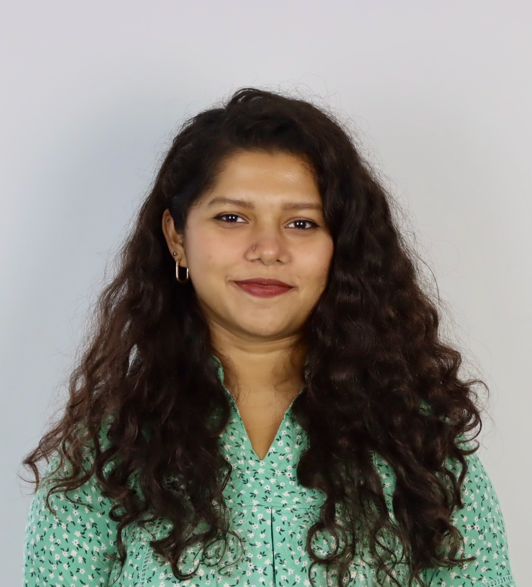

---
title: "Home"
draft: false
---
<!----!>

I'm a graduate student and teaching assistant. I'm finishing up my M.Sc. at the University of Alberta, supervised by <a href="https://bkacsmar.github.io//" target="_blank">Dr. Bailey Kacsmar</a> at the <a href="https://pupsresearchlab.github.io/" target="_blank">Practical Usable Privacy and Security (PUPS)</a> lab. My research interests at this moment are in the fields of Human Centered AI (HCAI), and desgining systems that keep user comfort and trust at its core. 
Prior to my Masters, I worked as a software engineer at <a href="https://www.welldev.io/client-stories/pidas" target="_blank">WellDev Bangladesh Ltd.</a> My <a href="https://www.linkedin.com/in/afrida-h-5114a8185/" target="_blank">Linkedin</a> has all the important details regarding my professional endeavors. 
